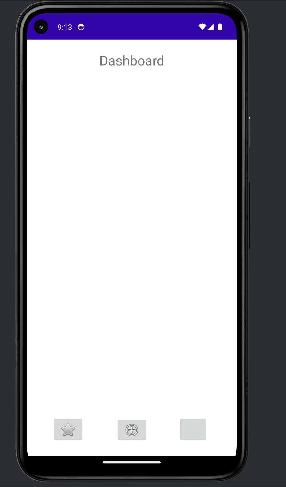
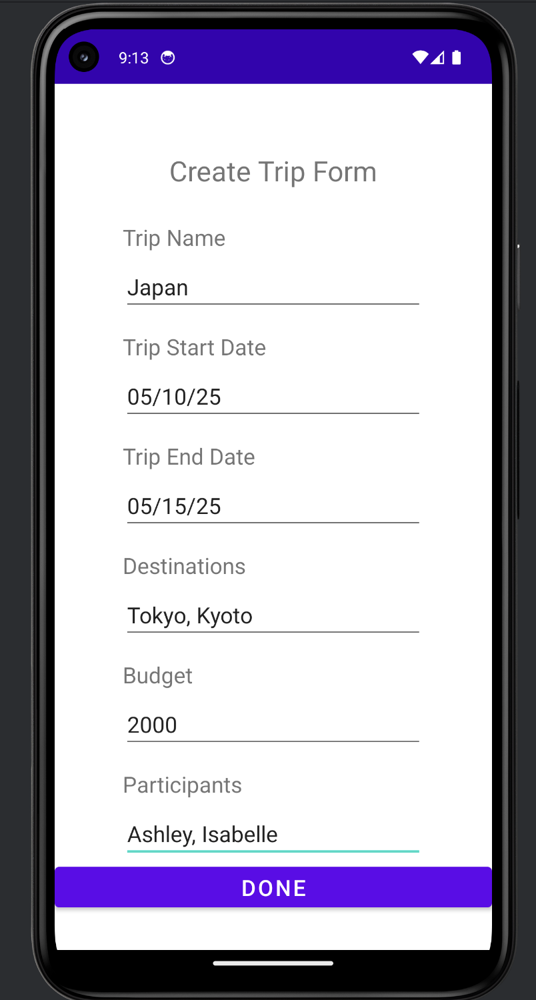
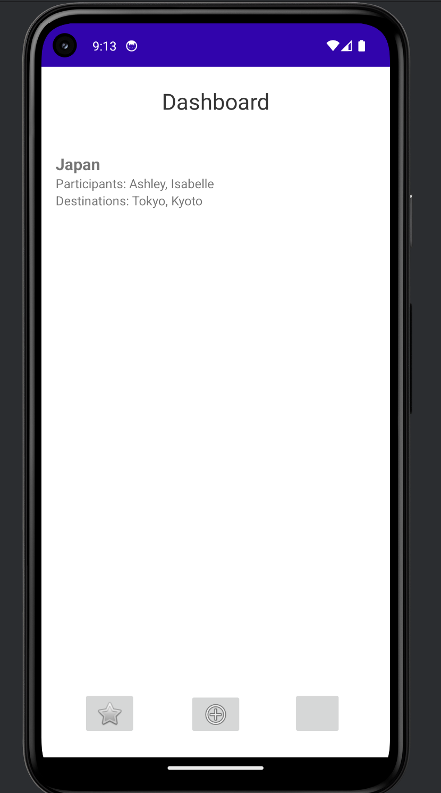
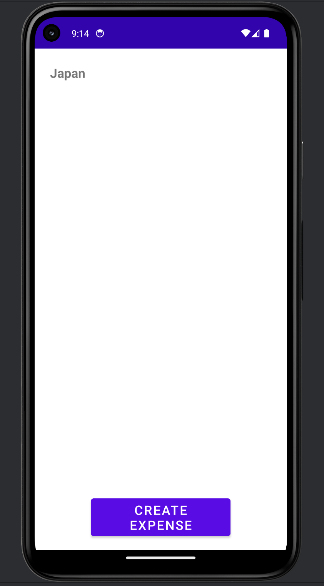
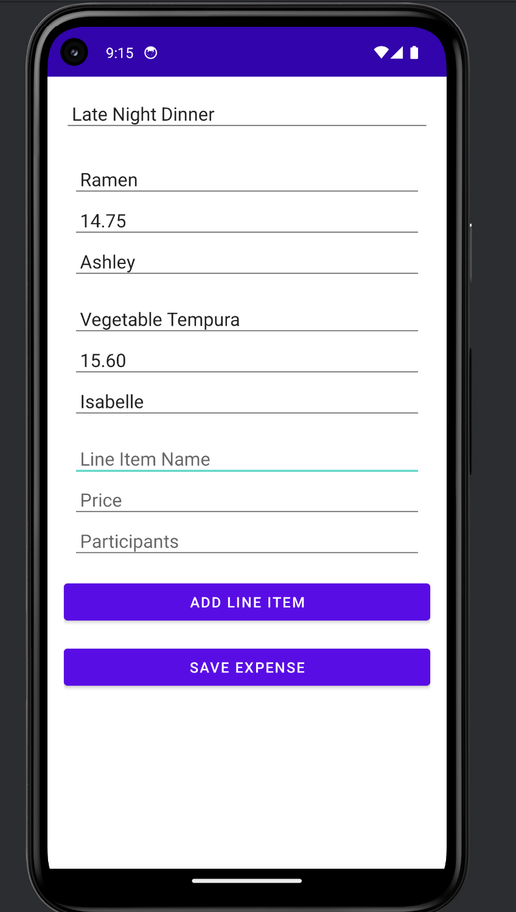
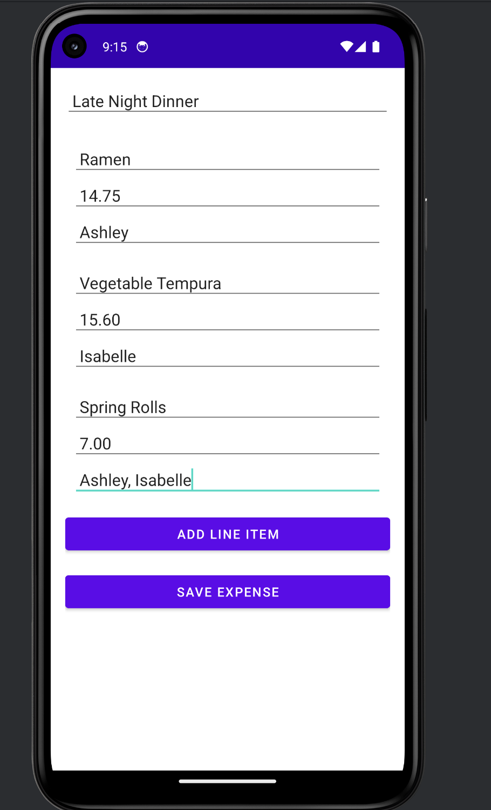
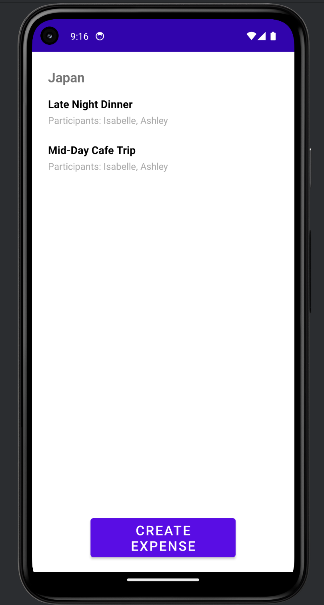

## **Implemented Functionality for Iteration 2**

### **1. Dashboard**
- The dashboard serves as the main screen when the app is created.
- Users can:
    - View a list of all created trips as widgets.
    - Create a new trip by clicking the **Create Trip** button.

### **2. Create Trip**
- **Form Details**:
    - **Name**: The name of the trip.
    - **Start Date**: The start date of the trip (MM/DD/YY).
    - **End Date**: The end date of the trip (MM/DD/YY).
    - **Destinations**: A comma-separated list of destinations (e.g., "Paris, Berlin").
    - **Budget**: The trip budget.
    - **Participants**: A comma-separated list of participant names.
- Upon submitting the form:
    - The trip is added to the dashboard dynamically.
    - A trip widget is created showing the trip name, participants, and destinations.

### **3. Trip Activity Feed**
- Clicking on a trip widget navigates to its **Activity Feed** screen.
- The screen displays:
    - **Trip Name** at the top.
    - A scrollable **Activity Feed** listing all expenses for the trip.
    - A **Create Expense** button to add a new expense.

### **4. Create Expense**
- **Form Details**:
    - **Expense Description**: A brief description of the expense (e.g., "Dinner with friends").
    - **Line Items**:
        - **Name**: The name of the item (e.g., "Taxi fare").
        - **Price**: The cost of the item.
        - **Participants**: A comma-separated list of participants involved in the expense.
    - Users can add multiple line items using the **Add Line Item** button.
- Upon submitting the form:
    - The expense is saved and associated with the selected trip.
    - The Trip Activity Feed is refreshed dynamically to display the new expense.

### **5. Dynamic Updates**
- Trips and expenses are updated dynamically across the app:
    - The **Dashboard** updates when a new trip is created.
    - The **Trip Activity Feed** refreshes automatically when an expense is added.

---

## **Known Limitations**
1. **Date Validation**:
    - Dates are validated to ensure the format is correct (MM/DD/YY), and to ensure the Start Date is before the End Date.
    - However, there is no check implemented for whether dates are in the future or past.

2. **Budget/Debt Tracking**:
    - Currently, the app does not calculate or enforce budget limits for trips.
    - The app doesn't keep track of owed dets or display it either for current active trips.

3. **Participant Matching**:
    - Participants in line items are stored as strings, this was implemented with simplicity in mind
      however, there's no validation or linking to actual user profiles yet.

---

## **To Run the Application**

### **Prerequisites**
- Android Studio must be installed
- Set a configuration with My_First_Application.app, and press the green play button at the top left. 
- The app should be run on Pixel 5 API 34 emulator.

