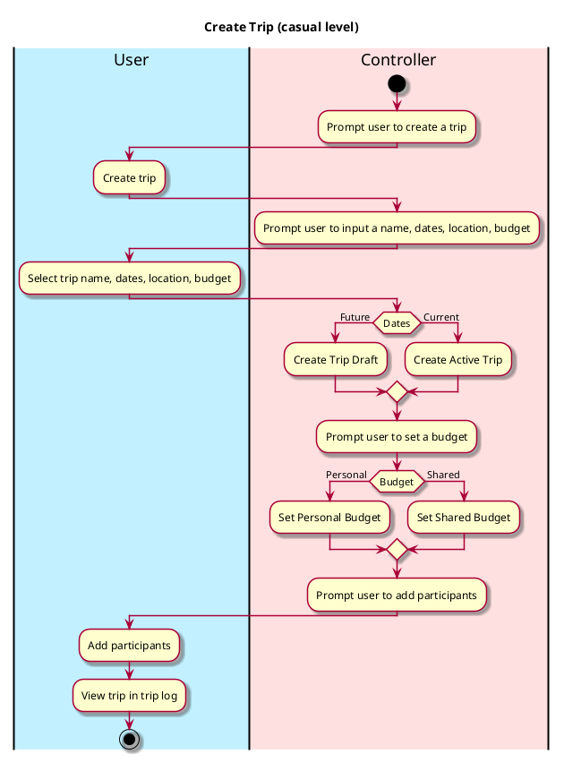
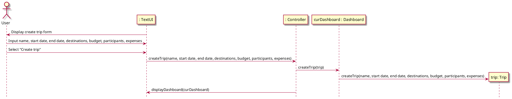

# Create Trip

## 1. Primary actor and goals
Who is the main interested party and what goal(s) this use case is designed to help them achieve:

* __User__: wants to create a new trip object that can later be shared with 
other party members.

## 2. Other stakeholders and their goals

* None

## 3. Preconditions

What must be true prior to the start of the use case.

* User must have signed up or logged in.

## 4. Postconditions

What must be true upon successful completion of the use case.

* Trip object is instantiated.
* The user has been prompted to...
  * name the trip
  * set the dates for a hypothetical trip or mark as current trip
  * select a location
  * add participants
  * set a personal and/or group budget
* Note: The user may opt to skip any of these steps for now and come back later to 
fill them in.

## 4. Workflow

The sequence of steps involved in the execution of the use case, in the form of one or more activity diagrams (please feel free to decompose into multiple diagrams for readability).

The workflow can be specified at different levels of detail:

* __Brief__: main success scenario only;
* __Casual__: most common scenarios and variations;
* __Fully-dressed__: all scenarios and variations.

# Sequence Diagram
