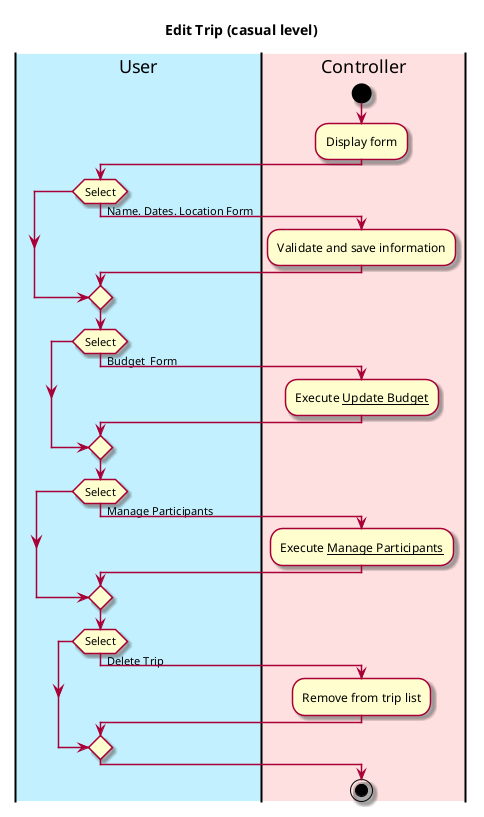
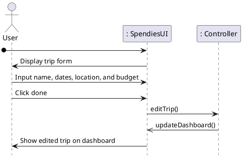

# Edit Trip

## 1. Primary actor and goals
Who is the main interested party and what goal(s) this use case is designed to help them achieve:

* __User__: wants to view a trip that has already been created or a trip that is in
trip drafts.

## 2. Other stakeholders and their goals

* None

## 3. Preconditions

What must be true prior to the start of the use case.

* User must have signed up or logged in.
* User must have created or drafted at least one trip.

## 4. Postconditions

What must be true upon successful completion of the use case.

* Trip is updated if information has been changed.
  * e.g. If the user chooses to change the location, dates. etc.
* Trip is added to the "active" trip log if a drafted trip has been completely planned.

## 4. Workflow

The sequence of steps involved in the execution of the use case, in the form of one or more activity diagrams (please feel free to decompose into multiple diagrams for readability).

The workflow can be specified at different levels of detail:

* __Brief__: main success scenario only;
* __Casual__: most common scenarios and variations;
* __Fully-dressed__: all scenarios and variations.

# Sequence Diagram
