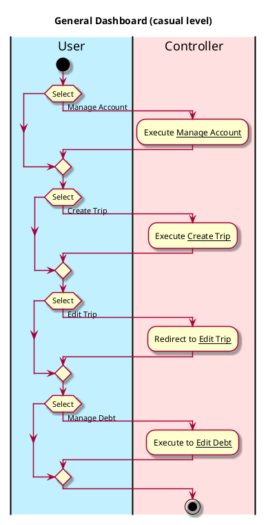
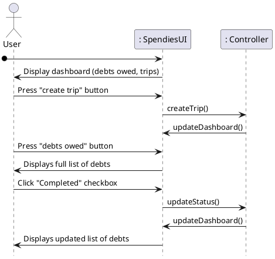

# General Dashboard

## 1. Primary actor and goals
Who is the main interested party and what goal(s) this use case is designed to help them achieve:

* __User__: wants to choose between creating a new trip and viewing/editing current trips.
  * Wants to view accurate information regarding what debts they owe and to who

## 2. Other stakeholders and their goals
* None

## 3. Preconditions

What must be true prior to the start of the use case.

* User must have signed up or logged in.

## 4. Postconditions

What must be true upon successful completion of the use case.

* The user is redirected to create a trip or view current trips.
* The user can view their current list of debts

## 4. Workflow

The sequence of steps involved in the execution of the use case, in the form of one or more activity diagrams (please feel free to decompose into multiple diagrams for readability).

The workflow can be specified at different levels of detail:

* __Brief__: main success scenario only;
* __Casual__: most common scenarios and variations;
* __Fully-dressed__: all scenarios and variations.

# Sequence Diagram

