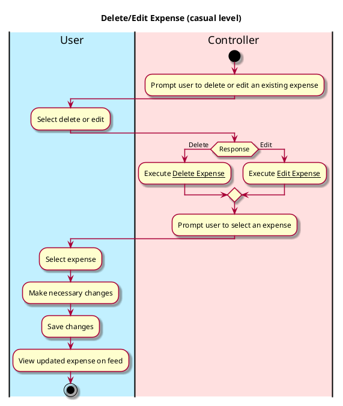
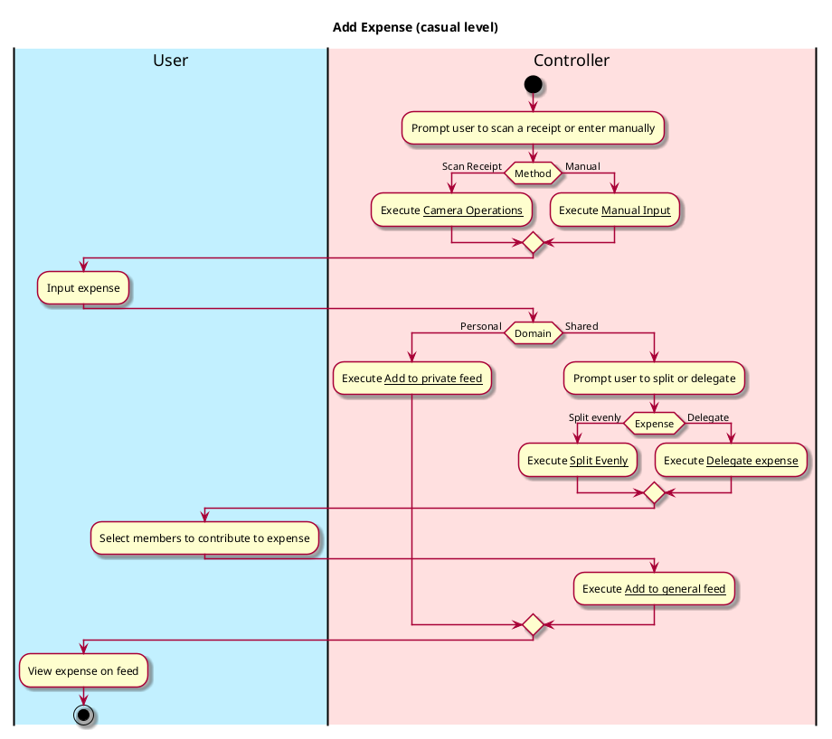

# Manage Expense

## 1. Primary actor and goals
Who is the main interested party and what goal(s) this use case is designed to help them achieve:

* __User__: wants to add and delegate, delete, or edit an expense, which should populate the activity feed if it
is not a personal expense. Wants quick processing time.

## 2. Other stakeholders and their goals

* __Other party members__: Want to be correctly notified of new expense changes.

## 3. Preconditions

What must be true prior to the start of the use case.

* User must have created or joined a trip.

## 4. Postconditions

What must be true upon successful completion of the use case.

* Expense is added and delegated, deleted, or edited according to the user's input.
* If added:
  * If expense is personal, add to personal activity feed. 
  * If expense is shared, add to general activity feed.
    * Expense is then delegated to specific party members.
    * Distribution of the expense is calculated.
    * User is shown how much they owe and how much is owed to them.
* If deleted:
  * Expense no longer appears in expense list.
* If edited:
  * New edit is accurately depicted in expense object.

    
## 4. Workflow

The sequence of steps involved in the execution of the use case, in the form of one or more activity diagrams (please feel free to decompose into multiple diagrams for readability).

The workflow can be specified at different levels of detail:

* __Brief__: main success scenario only;
* __Casual__: most common scenarios and variations;
* __Fully-dressed__: all scenarios and variations.






# Sequence Diagram
```plantuml
@startuml
hide footbox
actor User as user
participant ": SpendiesUI" as spendiesUI
participant ": Controller" as system
[o-> spendiesUI :
spendiesUI -> user : Display dashboard (debts owed, trips)
user -> spendiesUI : Press an existing trip
spendiesUI -> user : Display specific trip feed
user -> spendiesUI : Press "Add Expense"
spendiesUI -> system : addExpense()
system -> spendiesUI : updateDashboard()

user -> spendiesUI : Press an existing expense
spendiesUI -> user : Display specific expense details
user -> spendiesUI : Updates expense details

spendiesUI -> system : updateExpense()
system -> spendiesUI : updateDashboard()

user -> spendiesUI : Press "Delete Expense"

spendiesUI -> system : deleteExpense()
system -> spendiesUI : updateDashboard()
spendiesUI -> user : Displays updated list of debts


@enduml
``