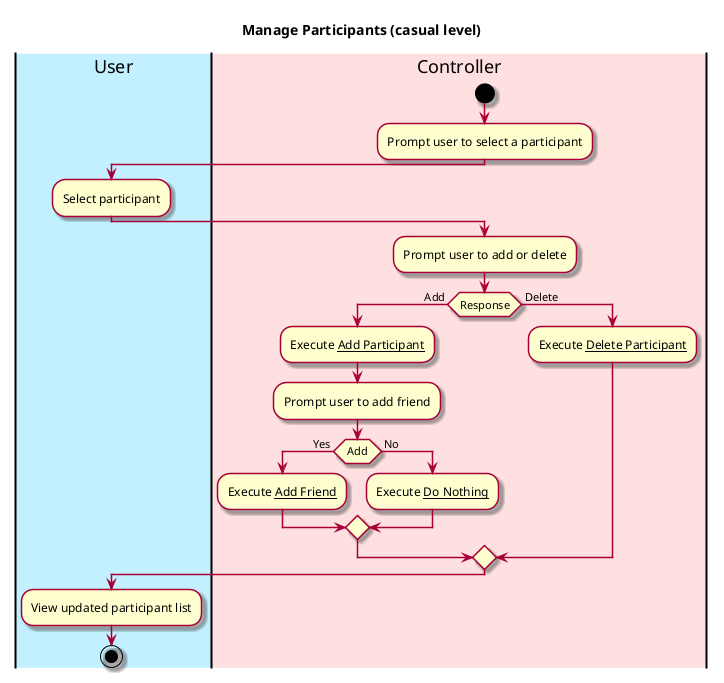

# Manage Participants

## 1. Primary actor and goals
Who is the main interested party and what goal(s) this use case is designed to help them achieve:

* __User__: wants to create a new trip object that can later be shared with
  other party members.

## 2. Other stakeholders and their goals

* None

## 3. Preconditions

What must be true prior to the start of the use case.

* User must have signed up or logged in.
* User must have created a trip.

## 4. Postconditions

What must be true upon successful completion of the use case.

* Participant is added or deleted according to the user's input.
* If added:
  * Participant receives a notification that they can join the trip via a shared link.
* If added and the "Add Friend" option is chosen:
  * Participant is added to the user's list of friends.
* If deleted:
  * The trip goes to the participant's past trips,  and they will no longer receive updates
    in the activity feed.


## 4. Workflow

The sequence of steps involved in the execution of the use case, in the form of one or more activity diagrams (please feel free to decompose into multiple diagrams for readability).

The workflow can be specified at different levels of detail:

* __Brief__: main success scenario only;
* __Casual__: most common scenarios and variations;
* __Fully-dressed__: all scenarios and variations.



# Sequence Diagram
```plantuml
@startuml
hide footbox
actor User as user
participant ": SpendiesUI" as spendiesUI
participant ": Controller" as system
[o-> spendiesUI :
spendiesUI -> user : Display dashboard (debts owed, trips)
user -> spendiesUI : Press an existing trip
spendiesUI -> user : Display specific trip feed
user -> spendiesUI : Press "Manage Party"
spendiesUI -> user : Display current participants
user -> spendiesUI : Select a current participants
spendiesUI -> user : Press "Delete" Button
spendiesUI -> system : removeParticipant()
system -> spendiesUI : updateParticipants()

user -> spendiesUI : Press an "Add Participants"
spendiesUI -> user : Display search Bar
user -> spendiesUI : Input participants username and selects "Add"

spendiesUI -> system : addParticipant()
system -> spendiesUI : updateParticipants()

spendiesUI -> user : Display updated list of Trip Participants

@enduml
``