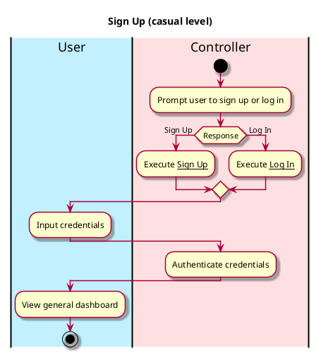
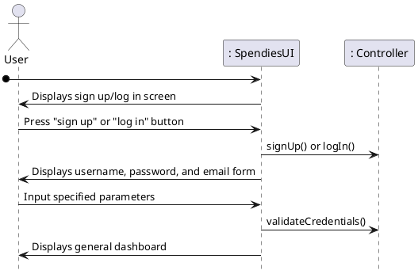

b# Sign Up

## 1. Primary actor and goals
Who is the main interested party and what goal(s) this use case is designed to help them achieve:

* __User__: wants to sign up to join Spendies or log in if they already have an account.

## 2. Other stakeholders and their goals

* None

## 3. Preconditions

What must be true prior to the start of the use case.

* User must have downloaded the app.

## 4. Postconditions

What must be true upon successful completion of the use case.

* User has a Spendies account.
* User is logged into their Spendies account.

## 4. Workflow

The sequence of steps involved in the execution of the use case, in the form of one or more activity diagrams (please feel free to decompose into multiple diagrams for readability).

The workflow can be specified at different levels of detail:

* __Brief__: main success scenario only;
* __Casual__: most common scenarios and variations;
* __Fully-dressed__: all scenarios and variations.

# Sequence Diagram

