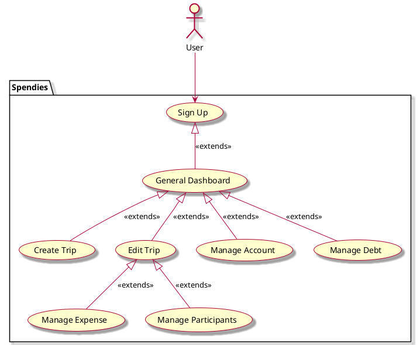

# Spendies - Vision Document

## 1. Introduction

Project Description:
An app for travelers to create budget-friendly trip itineraries and split group expenses
over the course of a vacation. The app features a social component, which allows users
to invite others to a trip and view past trips. Other features include establishing a 
group budget, trip drafting, categorization of expenses, currency exchange rates, an 
automated spending tracker, and budget-conscious activity recommendations.

One Line Summary: An app to split bills amongst friends and family during group trips.

## 2. Business case
Value Proposition:
For college students who need an all-inclusive budget tracker and bill splitter while on group trips with friends to reduce financial stress.
Split bills, not friendships - Adventure without the financial stress

## 3. Key functionality
* Create an account or Sign up page
* Add friends (Sending requests and accepting them)
* Create trips as a shareable link (we can save drafts as well, and maintain a 
  “Past Trips” history)
* Be able to add live expenses that appear within a trips activity feed
* Take a picture of receipts, and then have people claim items
* Be able to manually input prices as well, and select who's going to contribute to the 
  expense
* Be able to see who owes you, and who you owe with the amount

## 4. Stakeholder goals summary
- **User**: input and delegate expenses, create trips, set budget, add friends, have an accurate debt log

Nice-to-haves:
* Scan receipts
* Connect zelle/venmo i.e. third party 
* Allow other members of the party claim their own expenses

Target Audience:
* High-school aged and older
* Trip planners/people who enjoy traveling
* College students
* Parents/adults

Constraints:
* Must be written in Java
* Only available for Android users
* Will not act as a suggestion/recommendation platform for trip itineraries

## Use case diagram

